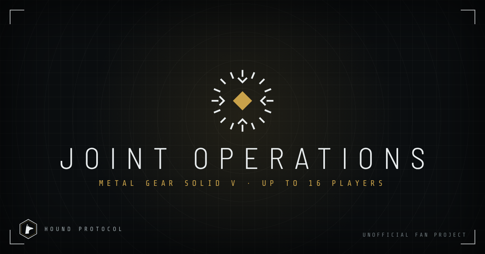

<p align="center">
  
</p>

<h1 align="center">MGSV: Joint Operations</h1>

<p align="center">
  <strong>A multiplayer mod for Metal Gear Solid V: The Phantom Pain. Up to 16 players in the open world.</strong><br>
  Windows and Linux (Proton) · Open source · Unofficial fan project
</p>

<p align="center">
  <a href="https://hound-protocol.github.io/Joint-Operations/">Website</a> ·
  <a href="https://hound-protocol.github.io/Joint-Operations/#/docs">Documentation</a> ·
  <a href="ROADMAP.md">Roadmap</a> ·
  <a href="https://discord.gg/QTpJ89kMCM">Discord</a> ·
  <a href="CHANGELOG.md">Changelog</a>
</p>

<p align="center">
  <a href="https://github.com/Hound-Protocol/Joint-Operations/actions/workflows/checks.yml"></a>
  <a href="https://github.com/Hound-Protocol/Joint-Operations/actions/workflows/pages.yml"></a>
  <a href="https://github.com/Hound-Protocol/Joint-Operations/releases"></a>
  <a href="https://discord.gg/QTpJ89kMCM"></a>
</p>

---

## About
**Joint Operations** brings the game's online functionality into the single-player world. One player is the **host**: they run the session and command it from the helicopter, the Command Center and Mother Base. Up to 15 **clients** join the host's session and deploy into the same world. Players arrive and leave through the game's own mechanics.

It is a **multiplayer mod**, not a co-op add-on, and it never touches Konami's online services, FOBs or anti-cheat.

> **Status: Foundation (v0.0.x).** The project's organization, documentation, website and research are in place. The first playable build is **0.1** (two players), developed by the project lead. Nothing is playable yet.

## Highlights
| | |
|---|---|
| **16 players** | One host and up to 15 clients, in free roam and missions |
| **Windows and Linux** | Native on Windows, Linux through Proton (tested on Bazzite) |
| **One-click join** | Planned: search servers on the website and deploy straight into the game ([ADR 0008](docs/decisions/0008-browser-launch.md)) |
| **Built in the open** | Every decision, risk and research note is public |

## Roadmap
| Phase | Goal | Status |
|---|---|---|
| 0 · Foundation | Organization, docs, website, research | Nearly complete |
| 1 · Research | Engine sessions, Steam networking, loading, state to sync | Desk research under way |
| 2 · Version 0.1 | Two players on Windows and Proton | Planned |
| 3 · Scale | 4, 8, then 16 players | Planned |
| 4 · Experience | Seamless join and leave, mod API, server browser | Planned |

Full details: [ROADMAP.md](ROADMAP.md).

## Hound Protocol
Hound Protocol is a non-commercial, community-focused organization. We build ambitious projects, one of them being Joint Operations. It is organized in four departments:

| Department | Role |
|---|---|
| **Administration** | Direction, decisions, accounts, community |
| **Development** | Architecture and code |
| **Quality** | Testing, reviews, release sign-off |
| **Contractor** | Contributors who take contracts and are graded E to S++ in each field |

Access works like keycards, from **LV1** (visitor) to **LV7** (owner), and every staff member has a verifiable **Hound ID**. Sign in on the website with GitHub to see your keycard and the restricted documents your clearance opens. Every completed contract earns a signed record that anyone can check on the website. See [departments and grades](docs/departments.md), [keycard access](docs/decisions/0011-keycard-access.md) and [sign-in](docs/decisions/0017-hound-id-sign-in.md).

## Get involved
- **Play:** follow the [Player Guide](docs/guides/HP-GDE-001-player-guide.md) when 0.1 is released.
- **Test:** testers on Windows and Linux are welcome now. Join the [Discord](https://discord.gg/QTpJ89kMCM) ([how](docs/guides/HP-GDE-008-discord-members.md)) and read the [Quality Guide](docs/guides/HP-GDE-004-quality-testing.md) and the [Tester's Field Manual](docs/guides/HP-GDE-020-testers-field-manual.md).
- **New to GitHub?** [GitHub Basics](docs/guides/HP-GDE-014-github-basics.md) takes you from no account to your first pull request.
- **Build:** contracts open after 0.1. Start with the [Contributor Quick Start](docs/guides/HP-GDE-003-contributor-quick-start.md) and [CONTRIBUTING.md](CONTRIBUTING.md).

Hand-written and AI-assisted work are welcome and credited equally, under the [AI Use Policy](docs/guides/HP-POL-002-ai-use-policy.md). Generative AI art, music and voices are not accepted.

## Documentation
| Area | Start here |
|---|---|
| Everything, by topic | [Knowledge map](docs/knowledge-map.md) |
| Handbook: guides, policies, procedures | [docs/guides/](docs/guides/) or the website's **Docs → Handbook** |
| Using the website | [HP-GDE-015](docs/guides/HP-GDE-015-using-the-website.md) |
| Plan and gates | [docs/pre-development.md](docs/pre-development.md) |
| Architecture | [docs/architecture.md](docs/architecture.md) |
| Decisions | [docs/decisions/](docs/decisions/README.md) |
| Research | [research/](research/README.md) |
| Contracts | [docs/contracts.md](docs/contracts.md) |
| Governance and team | [docs/governance.md](docs/governance.md) · [docs/team.md](docs/team.md) |
| Legal | [docs/legal.md](docs/legal.md) · [Clean-Room and IP Policy](docs/guides/HP-POL-003-clean-room-and-ip.md) |
| Security | [SECURITY.md](SECURITY.md) |

## Repository layout
```
docs/         plans, decisions, governance, and the handbook (docs/guides/)
research/     sourced research notes
site/         the website (deployed to GitHub Pages)
tools/        build, checks, Discord setup, contract and record tools, sign-in relay
.github/      CI workflows, templates, code owners
```

## Requirements and rules
- Your own legal copy of MGSV on Steam. This project does not distribute the game or any of its files.
- No game files, no copied mod code: see the [Clean-Room and IP Policy](docs/guides/HP-POL-003-clean-room-and-ip.md).

## License
Code is **GPL-3.0-only**, with a permission to run inside MGSV and link with the Steamworks SDK. Documentation is **CC BY-SA 4.0**. The Hound Protocol and Joint Operations names and logos are reserved. Forks are welcome; they must stay open, keep the credits and use their own name. Details: [LICENSING.md](LICENSING.md) and [ADR 0005](docs/decisions/0005-license.md).

## Disclaimer
MGSV: Joint Operations is an unofficial, fan-made, non-commercial project. It is not affiliated with, endorsed by or sponsored by Konami. *Metal Gear*, *Metal Gear Solid* and related names are trademarks of their respective owners.
